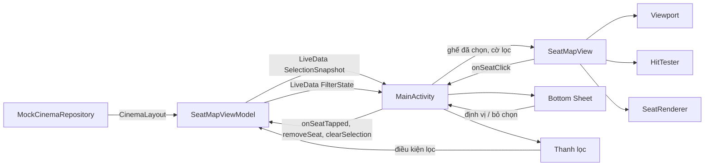

# Spatial Map – Sơ đồ phòng chiếu rạp phim

Ứng dụng Android vẽ **sơ đồ ghế phòng chiếu** trên **một Canvas duy nhất**. Người dùng có thể kéo
(Pan), chụm hai ngón để phóng to/thu nhỏ (Pinch-to-Zoom), chạm vào từng ghế để chọn/bỏ chọn,
lọc/tìm ghế, xem chú thích, đặt lại góc nhìn và quản lý danh sách ghế đã chọn trong một
Expandable Bottom Sheet đồng bộ hai chiều với sơ đồ. Dữ liệu là dữ liệu giả lập (mock), không
dùng API hay cơ sở dữ liệu.

> Học phần: Phát triển phần mềm cho thiết bị di động · Đề tài 2: Sơ đồ phòng chiếu rạp phim

## Mục lục

1. [Mô tả đề tài](#1-mô-tả-đề-tài)
2. [Tiến độ](#2-tiến-độ)
3. [Hướng dẫn chạy](#3-hướng-dẫn-chạy)
4. [Kiến trúc mã nguồn](#4-kiến-trúc-mã-nguồn)
5. [Tổ chức dữ liệu](#5-tổ-chức-dữ-liệu)
6. [Công thức chuyển đổi tọa độ](#6-công-thức-chuyển-đổi-tọa-độ)
7. [Phương pháp hit-testing](#7-phương-pháp-hit-testing)
8. [Quản lý trạng thái](#8-quản-lý-trạng-thái)
9. [Tối ưu hiệu năng](#9-tối-ưu-hiệu-năng)
10. [Video minh họa](#10-video-minh-họa)
11. [Nhật ký sử dụng AI Agent](#11-nhật-ký-sử-dụng-ai-agent)

## 1. Mô tả đề tài

Phòng chiếu có **198 ghế**, chia thành 3 phân khu, 3 khối ghế và 2 lối đi dọc:

| Phân khu | Hàng | Số ghế | Giá (mock) |
|---|---|---|---|
| Ghế thường (Standard) | A – D | 4 × 18 = 72 | 75.000đ |
| Ghế VIP | E – J | 6 × 18 = 108 | 95.000đ |
| Ghế đôi (Couple) | K – L | 2 × 9 = 18 | 180.000đ |

- Mỗi hàng gồm khối trái 4 ghế, khối giữa 10 ghế, khối phải 4 ghế. Hai lối đi dọc chạy từ
  phân khu đầu đến "LỐI VÀO" ở cuối phòng. Ghế đôi rộng bằng 2 ghế đơn.
- Các phân khu cách nhau bằng lối đi ngang, mỗi phân khu có nền màu riêng và nhãn tên kèm giá.
  Hai bên có nhãn hàng (A…L), phía trên là màn hình cong.
- **4 trạng thái trực quan**, phân biệt bằng cả màu, hình và biểu tượng:

| Trạng thái | Cách hiển thị |
|---|---|
| Còn trống | Ô bo góc tô màu theo loại ghế (xanh dương / vàng / hồng), có số ghế khi phóng to |
| Đang chọn | Ô xanh lá, viền sáng, dấu ✓ |
| Đã đặt | Ô xám đậm, dấu ✕, dải màu nhỏ phía trên cho biết loại ghế |
| Bị khóa (bảo trì) | Chỉ có viền nét đứt, biểu tượng ổ khóa |
| Ngoài bộ lọc | Ghế được vẽ mờ (độ trong suốt cao), không chọn được cho tới khi xóa bộ lọc |

**Công cụ hỗ trợ và Bottom Sheet**

| Chức năng | Cách hoạt động |
|---|---|
| Bảng chú thích | Dải nhỏ phía trên sơ đồ (màn ngang: cột phải). Ký hiệu được vẽ bằng chính lớp vẽ của sơ đồ nên luôn khớp: 3 loại ghế trống, đang chọn, đã đặt, bị khóa, ngoài bộ lọc, vòng sáng "đang định vị" |
| Bộ lọc | Chip theo loại ghế/phân khu (Thường, VIP, Đôi – chọn nhiều) và "Còn trống". Các điều kiện kết hợp bằng AND |
| Tìm kiếm | Gõ mã ghế: `E9` → đúng ghế E9, `E` (hoặc `hàng E`) → cả hàng E, `9` (hoặc `số 9`) → ghế số 9 mọi hàng. Lọc ngay khi gõ; bấm Tìm thì camera bay tới kết quả (một ghế: phóng to + vòng sáng nhấp nháy; nhiều ghế: đưa cả nhóm vào khung nhìn) |
| Kết quả lọc | Chip "Đang lọc · N ghế khớp ✕" cho biết đang có điều kiện và xóa tất cả bằng một chạm. Không có kết quả thì hiện dải "Không có ghế nào khớp" kèm nút Xóa bộ lọc ở mép trên sơ đồ (không che ghế đang định vị, không bị bàn phím che) |
| Ghế đã chọn khi lọc | Vẫn nằm trong danh sách. Nếu không khớp bộ lọc thì được vẽ mờ nhẹ nhưng giữ dấu ✓ và vẫn bỏ chọn được; trong Bottom Sheet có nhãn "Ngoài bộ lọc" |
| Reset View | Nút trên toolbar. Hiệu ứng 450 ms nội suy mức zoom (theo cấp số nhân) và tâm (tuyến tính) về góc nhìn mặc định. Không đụng tới bộ lọc hay ghế đã chọn |
| Bottom Sheet thu gọn | Số ghế đã chọn / tối đa, tổng tiền, danh sách mã ghế |
| Bottom Sheet mở rộng | Danh sách cuộn được: loại ghế, hàng, số, giá. Chạm một dòng để định vị ghế trên sơ đồ, nút ✕ để bỏ chọn, nút "Bỏ chọn tất cả". Màn dọc: sheet mở rộng luôn chừa lại ít nhất 40% vùng sơ đồ. Trạng thái mở/thu gọn được giữ khi xoay, kể cả khi xoay lúc sheet đang trượt |

## 2. Tiến độ

Dự án được làm theo hai giai đoạn.

**Giai đoạn 1 – đã hoàn thành**

- [x] 198 đối tượng trên một Canvas; phân khu, lối đi, nhãn rõ ràng ở mức zoom mặc định
- [x] 4 trạng thái trực quan; bỏ chọn trả ghế về đúng trạng thái gốc
- [x] Pan bằng một ngón (có fling) và giới hạn biên
- [x] Pinch-to-Zoom quanh tâm hai ngón tay, giới hạn 0,75× – 4× so với mức vừa khít màn hình
- [x] Chuyển đổi tọa độ Screen ↔ World; hit-testing chính xác sau Pan/Zoom và khi chạm gần mép ghế
- [x] Tách riêng dữ liệu / trạng thái / lớp vẽ; một nguồn trạng thái duy nhất (ViewModel)
- [x] Giữ ghế đang chọn và góc nhìn khi xoay màn hình; layout riêng cho dọc và ngang
- [x] Thẻ tóm tắt lựa chọn (số ghế, danh sách, tổng tiền) – giai đoạn 2 thay bằng Bottom Sheet
- [x] Hỗ trợ TalkBack: mỗi ghế là một virtual node (vẫn chỉ một Canvas)
- [x] 34 unit test cho phép biến đổi tọa độ, hit-testing, logic chọn ghế và dữ liệu

**Giai đoạn 2 – đã hoàn thành**

- [x] Bảng chú thích (Legend) đầy đủ màu, ký hiệu, trạng thái; không che sơ đồ
- [x] Bộ lọc theo loại ghế/phân khu và trạng thái, tìm kiếm theo mã ghế/hàng/số
- [x] Hiển thị điều kiện đang áp dụng, xóa điều kiện, thông báo khi không có kết quả
- [x] Reset View có hiệu ứng chuyển động, giữ nguyên bộ lọc và ghế đã chọn
- [x] Expandable Bottom Sheet (thay cho thẻ tóm tắt): thu gọn/mở rộng, cuộn, định vị ghế, xóa từng ghế
- [x] Đồng bộ hai chiều Canvas ↔ Bottom Sheet; nhất quán sau lọc, Reset View, xoay màn hình
- [x] Mức zoom tối đa luôn đủ để đọc số ghế (≥ 48dp/ghế), kể cả ở màn ngang hoặc cửa sổ hẹp
- [x] Tổng cộng 47 unit test (thêm test cho bộ lọc, tìm kiếm, zoom-to-fit, giới hạn zoom)
- [ ] Video minh họa

## 3. Hướng dẫn chạy

**Yêu cầu:** JDK 17, Android SDK 35 (Android Studio Ladybug trở lên). Thiết bị/emulator Android 7.0 (API 24) trở lên.

```bash
git clone https://github.com/24120012NhatNguyen/spatial_map.git
cd spatial_map
./gradlew assembleDebug          # build APK: app/build/outputs/apk/debug/app-debug.apk
./gradlew installDebug           # cài lên thiết bị/emulator đang kết nối
./gradlew testDebugUnitTest      # chạy unit test
```

Hoặc mở thư mục bằng Android Studio rồi bấm **Run**. Nếu Gradle không tìm thấy SDK, tạo file
`local.properties` chứa `sdk.dir=/đường/dẫn/Android/Sdk`.

**Thao tác:**

- Kéo một ngón để di chuyển, chụm/mở hai ngón để thu phóng (trên emulator: giữ **Ctrl** rồi kéo chuột).
- Chạm ghế trống để chọn, chạm lại để bỏ chọn.
- Gõ mã ghế vào ô tìm kiếm (ví dụ `E9`) rồi bấm Tìm; bật/tắt các chip để lọc; chạm chip
  "Đang lọc" để xóa bộ lọc.
- Nút ⛶ trên toolbar: đặt lại góc nhìn.
- Chạm hoặc vuốt phần tóm tắt ở dưới để mở Bottom Sheet; chạm một dòng để định vị ghế, ✕ để bỏ chọn.

## 4. Kiến trúc mã nguồn

```
app/src/main/java/com/example/cinemamap/
├── MainActivity.java            # Kết nối ViewModel ↔ các thành phần UI, không chứa logic
├── data/                        # DỮ LIỆU – Java thuần, bất biến
│   ├── Seat, SeatType, SeatStatus, Zone, RowLabel, WorldRect
│   ├── CinemaLayout.java        # Toàn bộ hình học phòng chiếu + tra cứu ghế theo mã
│   ├── MockCinemaRepository.java# Sinh dữ liệu giả lập (seed cố định)
│   └── PriceFormatter.java
├── state/                       # TRẠNG THÁI
│   ├── SeatSelection.java       # Logic chọn/bỏ chọn (Java thuần)
│   ├── SelectionSnapshot.java   # Ảnh chụp bất biến của lựa chọn
│   ├── SeatFilter.java          # Điều kiện lọc/tìm kiếm (Java thuần, bất biến)
│   ├── FilterState.java         # Kết quả lọc: cờ khớp theo ghế, số ghế khớp, khung bao kết quả
│   └── SeatMapViewModel.java    # Nguồn trạng thái duy nhất, LiveData + SavedStateHandle
└── ui/
    ├── SeatTypeColors.java      # Màu theo loại ghế, dùng chung
    ├── map/                     # LỚP VẼ & TƯƠNG TÁC
    │   ├── SeatMapView.java     # Custom View: cử chỉ, hit-test, hiệu ứng camera, lưu góc nhìn
    │   ├── SeatRenderer.java    # Vẽ lên Canvas, tái sử dụng Paint/Path/RectF
    │   ├── LegendView.java      # Bảng chú thích (dùng lại SeatRenderer để vẽ ký hiệu)
    │   ├── Viewport.java        # Phép biến đổi Screen ↔ World, giới hạn Pan/Zoom (Java thuần)
    │   └── HitTester.java       # Tìm ghế tại một điểm world (Java thuần)
    ├── filter/
    │   └── FilterBarController.java  # Ô tìm kiếm, chip lọc, chip trạng thái, thẻ "không có kết quả"
    └── sheet/
        ├── SelectionSheetController.java  # Expandable Bottom Sheet
        └── SelectedSeatAdapter.java       # RecyclerView + DiffUtil theo mã ghế
```

Luồng dữ liệu một chiều:



`SeatMapView` **không tự quyết định** ghế nào được chọn. Nó chỉ báo "ghế X vừa được chạm".
ViewModel áp dụng luật (ghế đã đặt/bị khóa, giới hạn 10 ghế, ghế đang bị lọc) rồi phát trạng thái
mới cho mọi thành phần UI. Bottom Sheet cũng không giữ danh sách riêng: mỗi lần trạng thái đổi,
danh sách được dựng lại từ `SelectionSnapshot` + `FilterState`. Nhờ vậy Canvas, thanh lọc và
Bottom Sheet luôn đồng bộ, không có mục trùng lặp hay lỗi thời.

## 5. Tổ chức dữ liệu

- Mọi hình học dùng **tọa độ world** (đơn vị độc lập với màn hình): ghế 32 × 32, khe 6, lối đi
  dọc 44, toàn bộ phòng khoảng 866 × 810.
- `Seat` (bất biến): `index`, `id` (ví dụ `E7`), `row`, `number`, `type`, `status` (trạng thái gốc),
  `bounds` (`WorldRect`). Nhãn số ghế được tạo sẵn để `onDraw()` không phải cấp phát chuỗi.
- `SeatStatus` chỉ gồm trạng thái gốc từ dữ liệu: `AVAILABLE`, `BOOKED`, `LOCKED`.
  **"Đang chọn" không nằm trong dữ liệu** mà là trạng thái phiên làm việc, lưu trong
  `SeatSelection`. Vì vậy bỏ chọn luôn trả ghế về đúng trạng thái trước đó và không ảnh hưởng ghế khác.
- `CinemaLayout` gom danh sách ghế, phân khu (`Zone` + vùng tiêu đề), lối đi, nhãn hàng và
  vùng màn hình, kèm `Map<String, Seat>` để tra cứu theo mã trong O(1).
- `MockCinemaRepository` dùng `Random` với seed cố định nên mã ghế và trạng thái luôn giống nhau
  giữa các lần chạy. Điều này cần thiết để khôi phục lựa chọn sau khi tiến trình bị hệ điều hành thu hồi.

## 6. Công thức chuyển đổi tọa độ

`Viewport` lưu tỷ lệ `s` và độ dịch `(tx, ty)`:

```
screenX = worldX · s + tx            worldX = (screenX − tx) / s
screenY = worldY · s + ty            worldY = (screenY − ty) / s
```

Khi vẽ, Canvas được biến đổi một lần: `canvas.translate(tx, ty); canvas.scale(s, s);`. Sau đó mọi
đối tượng được vẽ bằng tọa độ world.

**Zoom quanh tâm hai ngón tay** (`Viewport.transform`). Gọi `p` là tâm hai ngón ở khung trước,
`f` là tâm hiện tại, `k` là hệ số scale của khung:

```
world = (p − t) / s                 // điểm bản đồ đang nằm dưới hai ngón tay
s'    = clamp(s · k, sMin, sMax)    // sMin = 0,75·sFit, sMax = max(4·sFit, s48dp)
t'    = clampPan(f − world · s')    // đưa điểm đó tới tâm mới → vừa zoom vừa pan
```

Translation được tính từ cả hai tiêu điểm rồi mới giới hạn biên **một lần**, nên điểm dưới ngón tay
không bị trôi khi đang ở sát biên.

**Giới hạn Pan** (từng trục, `W` là kích thước sơ đồ đã scale, `c` là tâm vùng hiển thị):

```
c − W ≤ t ≤ c        ⇔   điểm chính giữa vùng hiển thị luôn nằm trên sơ đồ
```

Mỗi trục luôn có ít nhất một nửa vùng hiển thị chứa sơ đồ, nên sơ đồ không bao giờ bị kéo ra khỏi
màn hình. Ràng buộc này đủ rộng để zoom quanh một ghế sát mép (từ góc nhìn mặc định) không bị
giới hạn biên kéo lệch khỏi ngón tay. Unit test `pinchFromDefaultViewKeepsOffCenterSeatUnderFingers`
kiểm tra đúng kịch bản này.

## 7. Phương pháp hit-testing

1. Đổi điểm chạm sang world: `(wx, wy) = ((x − tx)/s, (y − ty)/s)`. Bước này đã tính đến Pan/Zoom
   hiện tại nên kết quả đúng ở mọi góc nhìn.
2. Chỉ xét các ghế **giao với vùng đang nhìn thấy**. Chạm sát mép màn hình không thể chọn một ghế
   đã khuất hẳn ngoài màn hình. Bottom Sheet thu gọn nằm ngoài vùng sơ đồ; khi mở rộng, sheet
   nhận toàn bộ chạm trên phần nó che nên không có chạm nào "lọt" xuống ghế bên dưới.
3. Duyệt các ghế (`HitTester.findSeatIndex`):
   - Điểm nằm trong một ghế thì chọn ghế đó (các ghế không chồng lấn nên kết quả là duy nhất).
   - Nếu không, chọn ghế có **khoảng cách tới biên gần nhất**, miễn là khoảng cách đó ≤ dung sai.
     Dung sai = `min(10dp / s, 0,4 × cạnh ghế)`, nên khi thu nhỏ vẫn dễ chạm, khi phóng to thì chính
     xác, và không bao giờ "với" sang ghế bên cạnh.
4. Với 198 ghế, duyệt tuyến tính O(n) chỉ mất vài micro giây mỗi lần chạm.
5. Ghế tìm được được gửi lên ViewModel. Nếu ghế đang bị bộ lọc làm mờ (và chưa được chọn) thì
   ViewModel trả về `FILTERED_OUT` và hiện thông báo, lựa chọn không đổi.

Unit test `HitTesterTest.hitTestingIsCorrectAfterPanAndZoom` kiểm tra cả 198 ghế sau khi zoom 3,2× và
pan: chạm vào tâm và sát mép trong của từng ghế đều trả về đúng ghế đó.

## 8. Quản lý trạng thái

- **Một nguồn trạng thái duy nhất:** `SeatMapViewModel` giữ `CinemaLayout`, `SeatSelection` và
  `SeatFilter`, phát hai luồng bất biến qua `LiveData`: `SelectionSnapshot` (ghế đã chọn, tổng tiền)
  và `FilterState` (điều kiện, cờ khớp từng ghế, số ghế khớp). Canvas, thanh lọc và Bottom Sheet
  chỉ đọc từ đây và gửi thao tác ngược về ViewModel.
- **Lọc không làm mất lựa chọn:** bộ lọc chỉ ảnh hưởng hiển thị và khả năng chọn ghế mới. Ghế đã
  chọn vẫn nằm trong danh sách; nếu không khớp thì mờ nhẹ (giữ dấu ✓), vẫn bỏ chọn được và được
  gắn nhãn "Ngoài bộ lọc" trong sheet.
- **Reset View** chỉ thay đổi `Viewport` (trạng thái của View), không chạm vào ViewModel.
- **Xoay màn hình:** ViewModel sống qua thay đổi cấu hình. Mã ghế đã chọn và điều kiện lọc còn được
  ghi vào `SavedStateHandle`, giúp khôi phục cả khi tiến trình bị thu hồi (mã không hợp lệ, trùng
  lặp hoặc vượt giới hạn sẽ bị loại). Chip và ô tìm kiếm tắt `saveEnabled` và được đổ lại từ
  ViewModel, nên View không tự khôi phục một trạng thái khác.
- **Góc nhìn:** `SeatMapView` lưu mức zoom tương đối và điểm world ở tâm. Nếu đang chạy hiệu ứng
  (Reset View, định vị ghế), nó lưu **đích đến** của hiệu ứng nên sau khi xoay góc nhìn vẫn đúng.
  Trạng thái thu gọn/mở rộng của Bottom Sheet được Activity lưu riêng (Material sẽ đưa trạng thái
  "đang trượt" về thu gọn), nên xoay màn hình lúc sheet đang mở dở vẫn giữ đúng yêu cầu.
- **Dọc / ngang:** màn dọc: tìm kiếm, chip, chú thích ở trên, sơ đồ ở giữa, Bottom Sheet ở dưới
  (sơ đồ chừa đúng chiều cao sheet thu gọn). Màn ngang (`layout-land`): sơ đồ bên trái dùng trọn
  chiều cao; cột phải (rộng tối đa 320dp và không quá 40% cửa sổ) chứa tìm kiếm, chip, chú thích
  và Bottom Sheet (mở rộng trong cột nên không bao giờ che sơ đồ). Bộ chứa tắt `splitMotionEvents` để cử chỉ pinch không bị tách thành chạm.

## 9. Tối ưu hiệu năng

- Tất cả `Paint`, `DashPathEffect`, `Path`, `LinearGradient` được tạo **một lần** (trong constructor
  hoặc `prepare()`). `RectF` của từng ghế, phân khu và lối đi được tính sẵn khi nạp layout.
  `onDraw()` không cấp phát đối tượng mới.
- **Culling:** chỉ vẽ ghế giao với vùng world đang hiển thị.
- **Level of detail:** ẩn số ghế khi cạnh ghế trên màn hình nhỏ hơn 22dp.
- **Chỉ vẽ lại khi cần:** `Viewport.panBy/transform` trả về việc góc nhìn có thay đổi hay không,
  và View chỉ `invalidate` khi có thay đổi (ví dụ chụm tiếp ở mức zoom tối đa thì không vẽ lại).
  Fling được giới hạn theo biên Pan nên tự dừng ở biên.
- Trạng thái chọn được chuyển thành mảng `boolean[]` theo chỉ số ghế, nên khi vẽ không phải tra
  `Set<String>` cho từng ghế.
- Nhãn phân khu có cỡ chữ tối thiểu theo dp để luôn đọc được. Kích thước nhãn chỉ được đo lại khi
  mức zoom đổi (không đo ở mỗi khung hình khi pan), và nhãn hàng nằm ngoài màn hình được bỏ qua.
- Kết quả lọc được tính **một lần** mỗi khi điều kiện đổi (`FilterState.compute`), rồi chuyển thành
  mảng `boolean[]` "vẽ mờ" theo chỉ số ghế. Làm mờ bằng cách đổi alpha của Paint có sẵn, không dùng
  `saveLayer`. Điều kiện không đổi thì ViewModel không phát lại; điều kiện đổi nhưng kết quả như cũ
  (ví dụ gõ `Z` rồi `ZZ`) thì Canvas và danh sách cũng không vẽ lại.
- Hiệu ứng camera và vòng sáng dùng hai `ValueAnimator` tạo sẵn và tái sử dụng; chạm vào sơ đồ là
  hủy hiệu ứng camera ngay.
- Danh sách trong Bottom Sheet dùng `RecyclerView` + `DiffUtil` theo mã ghế: chỉ dòng thay đổi được
  vẽ lại.

## 10. Video minh họa

Link video: _(cập nhật sau)_

## 11. Nhật ký sử dụng AI Agent

| AI Agent | Vai trò |
|---|---|
| **Claude Code** (Claude Opus 5.5) | Lập trình chính: phân tích đề, đề xuất kiến trúc, sinh mã và unit test, build, chạy thử trên emulator |
| **Codex CLI** (gpt-6.2-sol) | Reviewer độc lập, chỉ đọc mã. Mỗi giai đoạn review 2 vòng; mỗi vòng là một phiên mới, chỉ nhận đề bài và mục tiêu |

| Bước | Nhiệm vụ / mã liên quan | Lỗi, hạn chế phát hiện | Cách kiểm tra, điều chỉnh |
|---|---|---|---|
| GĐ1 – viết mã | `data/*`, `Viewport`, `HitTester`, `SeatRenderer`, `SeatMapView`, ViewModel | Màn ngang sơ đồ quá nhỏ | Unit test + chạy emulator; thêm `layout-land` |
| GĐ1 – review 2 vòng | Toàn bộ mã GĐ1 | 18 lỗi, ví dụ: crash khi khôi phục sau process death (`SavedState` không public), mất lần chạm nhanh thứ hai, tâm pinch lệch khi ở sát biên, TalkBack không tới được từng ghế | Kiểm lại từng lỗi trên mã, sửa cả 18, thêm test hồi quy |
| GĐ2 – viết mã | `SeatFilter`, `FilterState`, `LegendView`, hiệu ứng camera, Bottom Sheet | Crash do thứ tự khởi tạo static (`NONE` tạo trước `Pattern`); màn hình bị phủ xám do highlight focus mặc định của Android | Phát hiện khi chạy emulator, sửa và chạy lại |
| GĐ2 – review vòng 1 | Mã GĐ2 | 8 điểm: sheet mở rộng có thể che hết sơ đồ ở màn dọc thấp; thông báo "không có kết quả" che ghế đang định vị; ghế đã chọn nhưng không khớp lọc vẫn sáng; gợi ý "hàng E" không tìm được; vẽ lại thừa… | Sửa cả 8, thêm test |
| GĐ2 – review vòng 2 | Mã GĐ2 sau sửa | 8 điểm, nặng nhất: chính bản sửa "bỏ qua danh sách không đổi" ở vòng 1 gây race, chọn rồi bỏ chọn nhanh có thể để lại ghế trong sheet; tìm kiếm đưa ghế ra sau sheet; chú thích thiếu vòng định vị | Sửa cả 8, chạy lại trên emulator. Tổng 47/47 test pass |

**Chưa kiểm chứng:** emulator điều khiển qua `adb` chỉ có một ngón tay nên Pinch-to-Zoom mới được
kiểm bằng unit test; TalkBack chưa thử thật; xoay màn hình lúc sheet đang trượt và cửa sổ chia đôi
mới được kiểm qua phân tích mã.

**Nhận xét:** logic thuần (tọa độ, hit-test, lọc) do AI sinh chạy đúng và có test; lỗi thật nằm ở
chi tiết Android (vòng đời, cử chỉ, bố cục). Review độc lập nhiều vòng kết hợp chạy thử là cách bắt
các lỗi này hiệu quả, kể cả lỗi do chính bản sửa trước gây ra.
