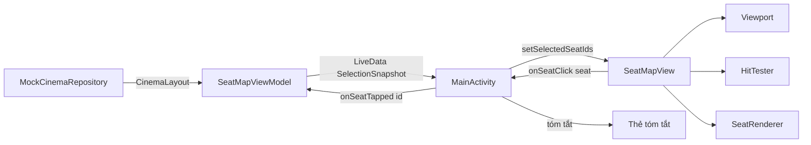

# Spatial Map – Sơ đồ phòng chiếu rạp phim

Ứng dụng Android vẽ **sơ đồ ghế phòng chiếu** trên **một Canvas duy nhất**. Người dùng có thể kéo
(Pan), chụm hai ngón để phóng to/thu nhỏ (Pinch-to-Zoom) và chạm vào từng ghế để chọn/bỏ chọn.
Dữ liệu là dữ liệu giả lập (mock), không dùng API hay cơ sở dữ liệu.

> Học phần: Phát triển phần mềm cho thiết bị di động · Đề tài 2: Sơ đồ phòng chiếu rạp phim

## Mục lục

1. [Mô tả đề tài](#1-mô-tả-đề-tài)
2. [Tiến độ](#2-tiến-độ)
3. [Hướng dẫn chạy](#3-hướng-dẫn-chạy)
4. [Kiến trúc mã nguồn](#4-kiến-trúc-mã-nguồn)
5. [Tổ chức dữ liệu](#5-tổ-chức-dữ-liệu)
6. [Công thức chuyển đổi tọa độ](#6-công-thức-chuyển-đổi-tọa-độ)
7. [Phương pháp hit-testing](#7-phương-pháp-hit-testing)
8. [Quản lý trạng thái](#8-quản-lý-trạng-thái)
9. [Tối ưu hiệu năng](#9-tối-ưu-hiệu-năng)
10. [Video minh họa](#10-video-minh-họa)
11. [Nhật ký sử dụng AI Agent](#11-nhật-ký-sử-dụng-ai-agent)

## 1. Mô tả đề tài

Phòng chiếu có **198 ghế**, chia thành 3 phân khu, 3 khối ghế và 2 lối đi dọc:

| Phân khu | Hàng | Số ghế | Giá (mock) |
|---|---|---|---|
| Ghế thường (Standard) | A – D | 4 × 18 = 72 | 75.000đ |
| Ghế VIP | E – J | 6 × 18 = 108 | 95.000đ |
| Ghế đôi (Couple) | K – L | 2 × 9 = 18 | 180.000đ |

- Mỗi hàng gồm khối trái 4 ghế, khối giữa 10 ghế, khối phải 4 ghế. Hai lối đi dọc chạy từ
  phân khu đầu đến "LỐI VÀO" ở cuối phòng. Ghế đôi rộng bằng 2 ghế đơn.
- Các phân khu cách nhau bằng lối đi ngang, mỗi phân khu có nền màu riêng và nhãn tên kèm giá.
  Hai bên có nhãn hàng (A…L), phía trên là màn hình cong.
- **4 trạng thái trực quan**, phân biệt bằng cả màu, hình và biểu tượng:

| Trạng thái | Cách hiển thị |
|---|---|
| Còn trống | Ô bo góc tô màu theo loại ghế (xanh dương / vàng / hồng), có số ghế khi phóng to |
| Đang chọn | Ô xanh lá, viền sáng, dấu ✓ |
| Đã đặt | Ô xám đậm, dấu ✕, dải màu nhỏ phía trên cho biết loại ghế |
| Bị khóa (bảo trì) | Chỉ có viền nét đứt, biểu tượng ổ khóa |

## 2. Tiến độ

Dự án được làm theo hai giai đoạn.

**Giai đoạn 1 – đã hoàn thành**

- [x] 198 đối tượng trên một Canvas; phân khu, lối đi, nhãn rõ ràng ở mức zoom mặc định
- [x] 4 trạng thái trực quan; bỏ chọn trả ghế về đúng trạng thái gốc
- [x] Pan bằng một ngón (có fling) và giới hạn biên
- [x] Pinch-to-Zoom quanh tâm hai ngón tay, giới hạn 0,75× – 4× so với mức vừa khít màn hình
- [x] Chuyển đổi tọa độ Screen ↔ World; hit-testing chính xác sau Pan/Zoom và khi chạm gần mép ghế
- [x] Tách riêng dữ liệu / trạng thái / lớp vẽ; một nguồn trạng thái duy nhất (ViewModel)
- [x] Giữ ghế đang chọn và góc nhìn khi xoay màn hình; layout riêng cho dọc và ngang
- [x] Thẻ tóm tắt lựa chọn (số ghế, danh sách, tổng tiền)
- [x] Hỗ trợ TalkBack: mỗi ghế là một virtual node (vẫn chỉ một Canvas)
- [x] 34 unit test cho phép biến đổi tọa độ, hit-testing, logic chọn ghế và dữ liệu

**Giai đoạn 2 – chưa làm**

- [ ] Bảng chú thích (Legend)
- [ ] Bộ lọc / tìm kiếm (theo phân khu, loại ghế, trạng thái) và thông báo khi không có kết quả
- [ ] Reset View có hiệu ứng chuyển động
- [ ] Expandable Bottom Sheet đồng bộ hai chiều với Canvas (thay cho thẻ tóm tắt hiện tại)
- [ ] Video minh họa

## 3. Hướng dẫn chạy

**Yêu cầu:** JDK 17, Android SDK 35 (Android Studio Ladybug trở lên). Thiết bị/emulator Android 7.0 (API 24) trở lên.

```bash
git clone https://github.com/24120012NhatNguyen/spatial_map.git
cd spatial_map
./gradlew assembleDebug          # build APK: app/build/outputs/apk/debug/app-debug.apk
./gradlew installDebug           # cài lên thiết bị/emulator đang kết nối
./gradlew testDebugUnitTest      # chạy unit test
```

Hoặc mở thư mục bằng Android Studio rồi bấm **Run**. Nếu Gradle không tìm thấy SDK, tạo file
`local.properties` chứa `sdk.dir=/đường/dẫn/Android/Sdk`.

**Thao tác:** kéo một ngón để di chuyển, chụm/mở hai ngón để thu phóng, chạm vào ghế trống để chọn,
chạm lại để bỏ chọn. Trên emulator, giữ **Ctrl** rồi kéo chuột để giả lập hai ngón tay.

## 4. Kiến trúc mã nguồn

```
app/src/main/java/com/example/cinemamap/
├── MainActivity.java            # Kết nối ViewModel ↔ View, hiển thị tóm tắt, xử lý insets
├── data/                        # DỮ LIỆU – Java thuần, bất biến
│   ├── Seat, SeatType, SeatStatus, Zone, RowLabel, WorldRect
│   ├── CinemaLayout.java        # Toàn bộ hình học phòng chiếu + tra cứu ghế theo mã
│   ├── MockCinemaRepository.java# Sinh dữ liệu giả lập (seed cố định)
│   └── PriceFormatter.java
├── state/                       # TRẠNG THÁI
│   ├── SeatSelection.java       # Logic chọn/bỏ chọn (Java thuần)
│   ├── SelectionSnapshot.java   # Ảnh chụp bất biến phát ra UI
│   └── SeatMapViewModel.java    # Nguồn trạng thái duy nhất, LiveData + SavedStateHandle
└── ui/map/                      # LỚP VẼ & TƯƠNG TÁC
    ├── SeatMapView.java         # Custom View: cử chỉ, hit-test, lưu góc nhìn
    ├── SeatRenderer.java        # Vẽ lên Canvas, tái sử dụng Paint/Path/RectF
    ├── Viewport.java            # Phép biến đổi Screen ↔ World, giới hạn Pan/Zoom (Java thuần)
    └── HitTester.java           # Tìm ghế tại một điểm world (Java thuần)
```

Luồng dữ liệu một chiều:



`SeatMapView` **không tự quyết định** ghế nào được chọn. Nó chỉ báo "ghế X vừa được chạm".
ViewModel áp dụng luật (ghế đã đặt/bị khóa, giới hạn 10 ghế) rồi phát trạng thái mới cho mọi thành
phần UI. Nhờ vậy Canvas và phần tóm tắt luôn đồng bộ.

## 5. Tổ chức dữ liệu

- Mọi hình học dùng **tọa độ world** (đơn vị độc lập với màn hình): ghế 32 × 32, khe 6, lối đi
  dọc 44, toàn bộ phòng khoảng 866 × 810.
- `Seat` (bất biến): `index`, `id` (ví dụ `E7`), `row`, `number`, `type`, `status` (trạng thái gốc),
  `bounds` (`WorldRect`). Nhãn số ghế được tạo sẵn để `onDraw()` không phải cấp phát chuỗi.
- `SeatStatus` chỉ gồm trạng thái gốc từ dữ liệu: `AVAILABLE`, `BOOKED`, `LOCKED`.
  **"Đang chọn" không nằm trong dữ liệu** mà là trạng thái phiên làm việc, lưu trong
  `SeatSelection`. Vì vậy bỏ chọn luôn trả ghế về đúng trạng thái trước đó và không ảnh hưởng ghế khác.
- `CinemaLayout` gom danh sách ghế, phân khu (`Zone` + vùng tiêu đề), lối đi, nhãn hàng và
  vùng màn hình, kèm `Map<String, Seat>` để tra cứu theo mã trong O(1).
- `MockCinemaRepository` dùng `Random` với seed cố định nên mã ghế và trạng thái luôn giống nhau
  giữa các lần chạy. Điều này cần thiết để khôi phục lựa chọn sau khi tiến trình bị hệ điều hành thu hồi.

## 6. Công thức chuyển đổi tọa độ

`Viewport` lưu tỷ lệ `s` và độ dịch `(tx, ty)`:

```
screenX = worldX · s + tx            worldX = (screenX − tx) / s
screenY = worldY · s + ty            worldY = (screenY − ty) / s
```

Khi vẽ, Canvas được biến đổi một lần: `canvas.translate(tx, ty); canvas.scale(s, s);`. Sau đó mọi
đối tượng được vẽ bằng tọa độ world.

**Zoom quanh tâm hai ngón tay** (`Viewport.transform`). Gọi `p` là tâm hai ngón ở khung trước,
`f` là tâm hiện tại, `k` là hệ số scale của khung:

```
world = (p − t) / s                 // điểm bản đồ đang nằm dưới hai ngón tay
s'    = clamp(s · k, sMin, sMax)    // sMin = 0,75·sFit, sMax = 4·sFit
t'    = clampPan(f − world · s')    // đưa điểm đó tới tâm mới → vừa zoom vừa pan
```

Translation được tính từ cả hai tiêu điểm rồi mới giới hạn biên **một lần**, nên điểm dưới ngón tay
không bị trôi khi đang ở sát biên.

**Giới hạn Pan** (từng trục, `W` là kích thước sơ đồ đã scale, `c` là tâm vùng hiển thị):

```
c − W ≤ t ≤ c        ⇔   điểm chính giữa vùng hiển thị luôn nằm trên sơ đồ
```

Mỗi trục luôn có ít nhất một nửa vùng hiển thị chứa sơ đồ, nên sơ đồ không bao giờ bị kéo ra khỏi
màn hình. Ràng buộc này đủ rộng để zoom quanh một ghế sát mép (từ góc nhìn mặc định) không bị
giới hạn biên kéo lệch khỏi ngón tay. Unit test `pinchFromDefaultViewKeepsOffCenterSeatUnderFingers`
kiểm tra đúng kịch bản này.

## 7. Phương pháp hit-testing

1. Đổi điểm chạm sang world: `(wx, wy) = ((x − tx)/s, (y − ty)/s)`. Bước này đã tính đến Pan/Zoom
   hiện tại nên kết quả đúng ở mọi góc nhìn.
2. Chỉ xét các ghế **giao với vùng đang nhìn thấy**. Chạm sát mép màn hình không thể chọn một ghế
   đã khuất hẳn ngoài màn hình. (`Viewport` cũng hỗ trợ inset cho vùng bị che, dùng cho Bottom
   Sheet ở giai đoạn 2: chạm vào vùng bị che sẽ bị bỏ qua.)
3. Duyệt các ghế (`HitTester.findSeatIndex`):
   - Điểm nằm trong một ghế thì chọn ghế đó (các ghế không chồng lấn nên kết quả là duy nhất).
   - Nếu không, chọn ghế có **khoảng cách tới biên gần nhất**, miễn là khoảng cách đó ≤ dung sai.
     Dung sai = `min(10dp / s, 0,4 × cạnh ghế)`, nên khi thu nhỏ vẫn dễ chạm, khi phóng to thì chính
     xác, và không bao giờ "với" sang ghế bên cạnh.
4. Với 198 ghế, duyệt tuyến tính O(n) chỉ mất vài micro giây mỗi lần chạm.

Unit test `HitTesterTest.hitTestingIsCorrectAfterPanAndZoom` kiểm tra cả 198 ghế sau khi zoom 3,2× và
pan: chạm vào tâm và sát mép trong của từng ghế đều trả về đúng ghế đó.

## 8. Quản lý trạng thái

- **Một nguồn trạng thái duy nhất:** `SeatMapViewModel` giữ `CinemaLayout` và `SeatSelection`,
  phát `SelectionSnapshot` bất biến qua `LiveData`. Canvas, phần tóm tắt (và sau này là bộ lọc,
  Bottom Sheet) đều đọc từ đây.
- **Xoay màn hình:** ViewModel sống qua thay đổi cấu hình nên không mất ghế đang chọn. Danh sách mã
  ghế còn được ghi vào `SavedStateHandle`, giúp khôi phục cả khi tiến trình bị thu hồi. Khi khôi
  phục, mã không hợp lệ, trùng lặp hoặc vượt giới hạn sẽ bị loại.
- **Góc nhìn:** `SeatMapView` lưu mức zoom tương đối và điểm world ở tâm vào `onSaveInstanceState`.
  Sau khi xoay, sơ đồ hiển thị đúng vùng đang xem với mức zoom tương ứng. Nếu người dùng chưa di
  chuyển thì sơ đồ giữ góc nhìn mặc định vừa khít màn hình mới.
- **Dọc / ngang:** sơ đồ và thẻ tóm tắt có vùng riêng, không đè lên nhau. Màn dọc đặt thẻ dưới sơ
  đồ. Màn ngang (`layout-land`) đặt thẻ ở cột bên phải và gộp toolbar thành một dòng để sơ đồ dùng
  trọn chiều cao. Thẻ cố định 2 dòng nên chọn ghế không làm sơ đồ đổi kích thước. Bộ chứa tắt
  `splitMotionEvents` để cử chỉ pinch có một ngón đặt lên thẻ không bị tách thành một lần chạm.

## 9. Tối ưu hiệu năng

- Tất cả `Paint`, `DashPathEffect`, `Path`, `LinearGradient` được tạo **một lần** (trong constructor
  hoặc `prepare()`). `RectF` của từng ghế, phân khu và lối đi được tính sẵn khi nạp layout.
  `onDraw()` không cấp phát đối tượng mới.
- **Culling:** chỉ vẽ ghế giao với vùng world đang hiển thị.
- **Level of detail:** ẩn số ghế khi cạnh ghế trên màn hình nhỏ hơn 22dp.
- **Chỉ vẽ lại khi cần:** `Viewport.panBy/transform` trả về việc góc nhìn có thay đổi hay không,
  và View chỉ `invalidate` khi có thay đổi (ví dụ chụm tiếp ở mức zoom tối đa thì không vẽ lại).
  Fling được giới hạn theo biên Pan nên tự dừng ở biên.
- Trạng thái chọn được chuyển thành mảng `boolean[]` theo chỉ số ghế, nên khi vẽ không phải tra
  `Set<String>` cho từng ghế.
- Nhãn phân khu có cỡ chữ tối thiểu theo dp để luôn đọc được. Kích thước nhãn chỉ được đo lại khi
  mức zoom đổi (không đo ở mỗi khung hình khi pan), và nhãn hàng nằm ngoài màn hình được bỏ qua.

## 10. Video minh họa

Link video: _(cập nhật sau)_

## 11. Nhật ký sử dụng AI Agent

### Công cụ đã dùng

| AI Agent | Vai trò |
|---|---|
| **Claude Code** (Anthropic, model Claude Opus 5.5) | Agent lập trình chính: phân tích đề, đề xuất kiến trúc, sinh mã nguồn và unit test, build, chạy app trên emulator để kiểm tra |
| **Codex CLI** (OpenAI, model gpt-6.2-sol) | Reviewer độc lập, chỉ đọc mã (sandbox read-only). Review 2 vòng, mỗi vòng là một phiên mới chỉ nhận ngữ cảnh đề bài và mục tiêu review, không được gợi ý trước chỗ cần soi |

### Nhật ký theo từng bước

| # | Nhiệm vụ giao cho Agent | Phần mã được sinh / chỉnh sửa | Lỗi hoặc hạn chế phát hiện | Cách kiểm tra, điều chỉnh |
|---|---|---|---|---|
| 1 | Phân tích đề, chọn đề tài và công nghệ, chia giai đoạn | — | Máy có sẵn Android SDK 35, AGP 8.7.3 nhưng chưa có plugin Kotlin, nên chọn Java + Custom View | Đối chiếu từng mục của đề (2.1, 3.x, thang điểm) để lập danh sách việc cho giai đoạn 1 |
| 2 | Tạo khung dự án và dữ liệu giả lập | `data/*`, Gradle wrapper, theme, màu trạng thái | — | `MockCinemaRepositoryTest`: 198 ghế (trong khoảng 150–250), mã duy nhất, không chồng lấn, đủ 3 loại và 3 trạng thái, dữ liệu không đổi giữa các lần chạy |
| 3 | Chuyển đổi tọa độ, giới hạn Pan/Zoom, hit-testing | `Viewport`, `HitTester` | — | Unit test: chuyển đổi hai chiều, giữ tiêu điểm khi zoom, giới hạn tỷ lệ, giới hạn pan, hit-test cả 198 ghế sau zoom 3,2× + pan |
| 4 | Quản lý trạng thái chọn ghế | `SeatSelection`, `SelectionSnapshot`, `SeatMapViewModel` | — | `SeatSelectionTest`: chọn/bỏ chọn, ghế đã đặt/bị khóa, giới hạn 10 ghế, khôi phục loại mã sai/trùng |
| 5 | Vẽ Canvas, xử lý cử chỉ, màn hình chính | `SeatRenderer`, `SeatMapView`, `MainActivity`, layout | Ở màn ngang sơ đồ quá nhỏ vì thẻ tóm tắt chiếm hết chiều ngang | Chạy trên emulator Pixel 6 (API 35), chụp màn hình dọc/ngang, chạm chọn ghế, xoay màn hình. Thêm `layout-land` |
| 6 | **Review độc lập vòng 1** (Codex) | Sửa `SeatMapView`, `Viewport`, `SeatRenderer`, layout | 9 vấn đề: `SavedState` không public nên có thể crash khi khôi phục sau process death; `GestureDetector` mặc định nuốt lần chạm thứ hai khi chạm nhanh; tâm pinch lệch khi ở sát biên; inset đến muộn làm sai góc nhìn sau xoay; chạm xuyên qua thẻ tóm tắt; nhãn quá nhỏ ở màn ngang; fling sau pinch; fling dừng sớm; vẽ lại thừa khi zoom ở giới hạn | Kiểm tra lại từng phát hiện trên mã nguồn, sửa cả 9. Thêm `Viewport.transform()` tính translation từ hai tiêu điểm rồi mới giới hạn biên một lần. Thêm 5 test hồi quy. Thử lại trên emulator: chạm nhanh 2 ghế liền kề, chạm vào thẻ, pan rồi chạm |
| 7 | **Review độc lập vòng 2** (Codex, phiên mới) | Sửa `Viewport`, `HitTester`, `SeatMapView`, `SeatRenderer`, layout | 9 vấn đề mới: ở màn ngang cả dải phải bị chặn chạm dù vẫn thấy ghế; giới hạn pan kiểu "lề cố định" vẫn kéo lệch tâm pinch khi zoom từ góc nhìn mặc định; chạm sát mép có thể chọn ghế đã khuất; tâm đã lưu có thể mất khi xoay; split touch biến pinch thành một lần chạm; nhãn màn ngang còn nhỏ; thẻ đổi chiều cao làm sơ đồ xê dịch; TalkBack chưa truy cập được từng ghế; đo nhãn ở mỗi khung hình | Đổi sang giới hạn pan "tâm màn hình luôn nằm trên sơ đồ". Tách vùng sơ đồ và thẻ tóm tắt. Hit-test chỉ trên ghế nhìn thấy. Tắt `splitMotionEvents`. Cố định 2 dòng cho thẻ. Thêm `ExploreByTouchHelper`. Cache kích thước nhãn. Thêm test cho kịch bản pinch và ghế khuất. 34/34 test pass, chạy lại trên emulator |

### Hạn chế còn lại và phần chưa kiểm chứng

- Emulator điều khiển qua `adb` chỉ giả lập được một ngón tay, nên Pinch-to-Zoom mới được kiểm chứng
  bằng unit test của `Viewport` (công thức và các kịch bản sát biên), chưa thao tác thật trên thiết
  bị. Cần kiểm tra trực tiếp khi quay video (trên emulator: giữ Ctrl rồi kéo chuột).
- Virtual node cho TalkBack đã được thêm nhưng chưa thử với TalkBack thật.
- Các chức năng của giai đoạn 2 (mục 2) chưa làm.

### Nhận xét

Phần logic thuần (tọa độ, hit-testing, chọn ghế) do AI sinh ra chạy đúng ngay từ đầu và có test.
Các lỗi thực sự nằm ở những chi tiết đặc thù Android mà unit test JVM không bắt được: reflection của
`Parcel`, `GestureDetector` tự đăng ký listener double-tap, thứ tự layout/inset, split touch.
Review độc lập nhiều vòng, cộng với chạy thử trên emulator, là cách hiệu quả để phát hiện các lỗi này.
